# last30days-news

A desktop-style reader for the last 30 days of technology news. RSS feeds and other news sources land in one database, duplicate stories are merged, and optional AI summaries explain what matters.



No account. No hosted service for the local install. One process, one database file, one password.

## Install

Requires Node.js 26.13.0. npm ships with Node.js.

### Release tarball

```bash
npm install -g https://github.com/Emmraan/last30days-news/releases/latest/download/last30days-news.tgz
last30days
```

### npx

```bash
npx last30days-news
```

### npm

```bash
npm i -g last30days-news
last30days
```

The app starts at `http://127.0.0.1:4477`, opens your browser and prints the data directory. The first run uses the password `last30`. Change it in Settings after you sign in.

## Documentation

Full guides for local use, Docker, VPS, Vercel, configuration, passwords, uninstalling and development:

**https://last30days-docs.vercel.app/docs**

Use the docs for every install method not listed above.

## Development

```bash
pnpm install --frozen-lockfile
pnpm dev
```

`pnpm dev` loads `.env.development`. Copy `.env.development.example` first if you need Turso or other overrides.

The inner loop is `pnpm lint:changed`, `pnpm typecheck:changed` and `pnpm test:changed`. Before a merge, run the full gate:

```bash
pnpm lint && pnpm typecheck && pnpm test && pnpm build && pnpm build:landing && pnpm budget && pnpm test:smoke && pnpm test:package && pnpm audit:gate
```

Read [CONTRIBUTING.md](CONTRIBUTING.md) before opening a pull request. This project follows [CODE_OF_CONDUCT.md](CODE_OF_CONDUCT.md).

## Releases

Releases are automatic. When CI passes on `main`, semantic-release reads Conventional Commits, creates a GitHub tag and Release, and publishes to npm only when `NPM_TOKEN` is configured in the `release` environment. The first release is `1.0.0`. Do not create tags or publish from a laptop.

Write commit messages as `feat:`, `fix:`, `docs:`, `test:`, `refactor:`, `ci:` or `chore:` so the release notes stay accurate.

## Security

Report vulnerabilities privately. See [SECURITY.md](SECURITY.md). Do not open a public issue for a security problem.

## License

MIT. See [LICENSE](LICENSE).
