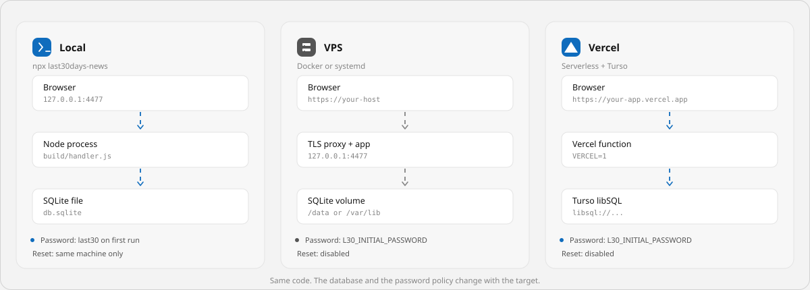
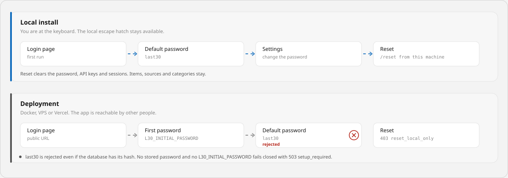

# last30days-news

A desktop-style reader for the last 30 days of technology news. RSS and Hacker News sources land in one database, duplicate stories are merged, and optional AI summaries explain what matters.


No account. No hosted service for the local install. One process, one database file, one password.

**Start here:** [Run locally](#run-locally) · [Deploy to Vercel](#deploy-to-vercel) · [Run on a VPS](#run-on-a-vps) · [Environment variables](#environment-variables) · [Passwords and recovery](#passwords-and-recovery) · [Development](#development)

## What you get

- One feed from RSS and Hacker News, with duplicate stories merged.
- Categories, full-text search, 24h/7d/30d ranges and read state.
- Optional AI summaries with citations, using your own provider key.
- A local SQLite file, or Turso when you deploy to Vercel.
- A single-user password gate with a local recovery path and a stricter deployed mode.
- A Windows-desktop-style UI: sidebar, feed, detail pane and keyboard shortcuts.

The local install keeps everything in one SQLite file on your machine. API keys are encrypted at rest and never reach the browser. There is no account or analytics service.

## Requirements

- **Local:** Node.js 26.13.0.
- **Development:** Node.js 26.13.0 and pnpm 12.16.1.
- **VPS:** Node.js 26.13.0 and pnpm 12.16.1, or Docker.
- **Vercel:** a Vercel account and a Turso libSQL database.

## Choose where to run it

|                    | Local                          | Vercel                                 | VPS                                       |
| ------------------ | ------------------------------ | -------------------------------------- | ----------------------------------------- |
| **Best for**       | One machine, quick start       | A public URL with no server to manage  | An always-on private reader               |
| **Database**       | SQLite file                    | Turso libSQL                           | SQLite file on a volume                   |
| **First password** | `last30`, then change it       | `L30_INITIAL_PASSWORD` (8+ characters) | `L30_INITIAL_PASSWORD` (8+ characters)    |
| **Password reset** | `/reset` from the same machine | Disabled                               | Disabled                                  |
| **Config**         | `.env.development`             | Vercel project settings                | `/etc/last30days-news.env` or Docker `-e` |



## Run locally

Requirements: Node.js 26.13.0.

```bash
npx last30days-news
```

The command starts the reader at `http://127.0.0.1:4477`, opens your browser and prints the data directory. The first run uses the password `last30`. Change it in Settings after you sign in.

If port 4477 is busy, the command tries 4477 through 4487. Set `PORT` to pin one:

```bash
# macOS / Linux
PORT=4480 npx last30days-news
```

On Windows PowerShell, set `$env:PORT = 4480` first. `HOST` defaults to `127.0.0.1`. Keep it there unless a reverse proxy is in front of the app.

### Data location

- Windows: `%APPDATA%\last30days-news`
- macOS: `~/Library/Application Support/last30days-news`
- Linux: `$XDG_DATA_HOME/last30days-news`, or `~/.local/share/last30days-news`
- Any platform: `L30_DATA_DIR` overrides the default

The database is `<data-dir>/db.sqlite`, with WAL mode and foreign keys enabled.

### Command line

```text
last30days [options]

  --no-open       Do not open the browser
  --version, -v   Print the version
  --help, -h      Print help
```

Set `L30_DEBUG=1` for verbose logs. Logs are newline-delimited JSON.

To run from a checkout instead, use the [development setup](#development).

## Deploy to Vercel

[](https://vercel.com/new/clone?repository-url=https%3A%2F%2Fgithub.com%2FEmmraan%2Flast30days-news&env=TURSO_DATABASE_URL,TURSO_AUTH_TOKEN,L30_INITIAL_PASSWORD&envDescription=Turso%20libSQL%20URL%20%28libsql%3A%2F%2F...%29%2C%20auth%20token%2C%20and%20an%208%2B%20character%20first%20password&envLink=https%3A%2F%2Fgithub.com%2FEmmraan%2Flast30days-news%23environment-variables&project-name=last30days-news&repository-name=last30days-news)

Vercel runs the app as a serverless function. The function filesystem is ephemeral, so the database must be a Turso libSQL database.

1. Create a Turso libSQL database and a development branch.
2. Click the button above.
3. Set the environment variables Vercel asks for:
   - `TURSO_DATABASE_URL`: the branch URL, starting with `libsql://`
   - `TURSO_AUTH_TOKEN`: the token for that database
   - `L30_INITIAL_PASSWORD`: an 8+ character first password
4. Deploy.
5. Sign in with `L30_INITIAL_PASSWORD`, then change it in Settings.

Vercel sets `VERCEL=1`, which selects the Vercel adapter and turns on deployed mode. You do not need to set `L30_DEPLOYED` on Vercel.

Use a Turso **libSQL** database, not the newer Turso Database engine. A `turso://` URL does not work with this app's libSQL driver. The URL must start with `libsql://`.

### Test the Turso branch locally first

This catches database and credential problems before a deployment.

1. Create a fresh development branch in Turso. Do not use the production branch.
2. Copy `.env.development.example` to `.env.development`.
3. Fill `TURSO_DATABASE_URL` and `TURSO_AUTH_TOKEN` from that branch.
4. Run `pnpm dev`, sign in with `last30`, change the password, and check the feed and refresh.

A fresh branch starts in the local first-run state, so `last30` works until you change it. Changing it writes a password hash to that branch. That is why the development branch should be separate.

On Vercel, `/api/refresh` processes one batch per request and the client polls until it finishes. Sessions, login attempts and settings all live in Turso, so they survive between function invocations.

## Run on a VPS

Both VPS paths are deployments. They set `L30_DEPLOYED=1`, require `L30_INITIAL_PASSWORD`, reject `last30` and disable password reset.

### Docker

```bash
docker build -t last30days-news .
docker run -d --name last30days-news \
  -p 127.0.0.1:4477:4477 \
  -v last30days-data:/data \
  -e L30_INITIAL_PASSWORD='choose-a-password' \
  last30days-news
```

The image sets `L30_DEPLOYED=1`, runs as UID 1000 and stores data in `/data`. Keep the published port on `127.0.0.1` and put a TLS proxy in front. For a quick check from your own machine, use an SSH tunnel:

```bash
ssh -L 4477:127.0.0.1:4477 user@your-host
```

Then open `http://127.0.0.1:4477`. If you bind-mount a host directory instead of a named volume, make it writable by UID 1000. The container warns if `/data` is not a mounted volume, because data would disappear with the container.

### systemd

1. Install Node.js 26.13.0 and pnpm 12.16.1 on the host.
2. Create the service user and directories:

   ```bash
   sudo useradd --system --home /var/lib/last30days-news --shell /usr/sbin/nologin last30days
   sudo mkdir -p /opt/last30days-news /var/lib/last30days-news
   sudo chown -R last30days:last30days /opt/last30days-news /var/lib/last30days-news
   ```

3. Clone and build as the service user:

   ```bash
   sudo -u last30days git clone https://github.com/Emmraan/last30days-news.git /opt/last30days-news
   cd /opt/last30days-news
   sudo -u last30days pnpm install --frozen-lockfile
   sudo -u last30days pnpm build
   ```

4. Create the environment file and add `L30_INITIAL_PASSWORD`:

   ```bash
   sudo install -m 600 -o root -g root /dev/null /etc/last30days-news.env
   sudoedit /etc/last30days-news.env
   ```

   ```text
   L30_INITIAL_PASSWORD=choose-a-password
   ```

5. Install and start the unit:

   ```bash
   sudo cp deploy/last30days-news.service /etc/systemd/system/
   sudo systemctl daemon-reload
   sudo systemctl enable --now last30days-news
   sudo systemctl status last30days-news
   ```

6. Put a TLS proxy in front of `127.0.0.1:4477`. A minimal Caddyfile:

   ```text
   news.example.com {
       reverse_proxy 127.0.0.1:4477
   }
   ```

The unit already sets `L30_DEPLOYED=1`, `HOST=127.0.0.1` and `L30_TRUST_PROXY=1`. Only keep `L30_TRUST_PROXY=1` when the proxy overwrites `X-Forwarded-For` and `X-Forwarded-Proto`. If it does not, remove that line so clients cannot spoof their address.

## Environment variables

| Variable               | Local                          | Vercel                           | VPS / Docker                          | What it does                                                                  |
| ---------------------- | ------------------------------ | -------------------------------- | ------------------------------------- | ----------------------------------------------------------------------------- |
| `PORT`                 | packaged app                   | ignored                          | set by image or unit                  | Listen port for `npx` and `start:local`. Default 4477; `npx` tries 4477–4487. |
| `HOST`                 | packaged app                   | ignored                          | set by image or unit                  | Bind address for `npx` and `start:local`. Default 127.0.0.1.                  |
| `L30_DATA_DIR`         | optional                       | ignored                          | `/data` or `/var/lib/last30days-news` | SQLite folder. Ignored when Turso is set.                                     |
| `TURSO_DATABASE_URL`   | optional                       | required                         | optional                              | Turso libSQL URL, starting with `libsql://`.                                  |
| `TURSO_AUTH_TOKEN`     | optional                       | required                         | optional                              | Auth token for that Turso database.                                           |
| `L30_DEPLOYED`         | only to test deployed mode     | not needed, `VERCEL=1` covers it | set by Docker and the unit            | Disables the local default password and reset.                                |
| `L30_INITIAL_PASSWORD` | optional test value            | required on first boot           | required on first boot                | 8+ character first password. Read only while no password is stored.           |
| `L30_DEBUG`            | optional                       | optional                         | optional                              | Verbose logs.                                                                 |
| `L30_TRUST_PROXY`      | only behind a proxy            | not needed                       | only behind a proxy                   | Trust `X-Forwarded-*` headers. The proxy must overwrite them.                 |
| `CI`                   | optional                       | ignored                          | optional                              | Skip opening the browser in the packaged app.                                 |
| `VERCEL`               | only for a local adapter check | set by the platform              | ignored                               | Selects the Vercel adapter. Do not set it manually on a server.               |

### Where to put the values

- **Local development:** copy `.env.development.example` to `.env.development`. `pnpm dev` loads it. Real values stay out of git.
- **Local production-like run:** copy `.env.production.example` to `.env.production`. `pnpm build` loads it, and `pnpm start:local` runs the built app with it.
- **Vercel:** add the variables in Project Settings, not in a file. Vercel sets `VERCEL=1` for you.
- **Docker:** pass values with `-e` or `--env-file`.
- **systemd:** put them in `/etc/last30days-news.env` and keep the file mode `600`.

The example files contain dummy values only. `.env.development` and `.env.production` are ignored by git.

## Passwords and recovery



### Local install

- First run: sign in with `last30`.
- Change it in Settings. The app shows a single banner until you do.
- Forgot it? Open `http://127.0.0.1:4477/reset` from the same machine. Reset clears the password, saved API keys and sessions. Items, sources and categories stay.

The local reset route is loopback only. A remote client gets `403 reset_local_only`.

### Deployments

Docker, VPS and Vercel are deployments. They run with `L30_DEPLOYED=1` or `VERCEL=1` and follow stricter rules:

- `L30_INITIAL_PASSWORD` is required on the first boot. It must be at least 8 characters.
- `last30` is always rejected, even if an old database already stores its hash.
- If no password is stored and no initial password is set, login fails closed with `503 setup_required`.
- Password reset is disabled. Remote and local callers get `403 reset_local_only`.
- `L30_INITIAL_PASSWORD` is read only while no password is stored. After the first boot, change the password in Settings. Changing the environment variable later does nothing.

### Recover a deployment

Stop the app, delete the password material, set a fresh initial password, then start again.

For a local SQLite file:

```bash
sqlite3 /path/to/db.sqlite "DELETE FROM setting WHERE key IN ('auth.password', 'crypto.salt') OR key LIKE 'secret.%';"
```

For Turso, run the same statement in the Turso console. Then set a new `L30_INITIAL_PASSWORD` in the environment and restart or redeploy. Items, sources and categories stay. Saved API keys must be entered again.

## Troubleshooting

- **`URL_SCHEME_NOT_SUPPORTED` or a `turso:` error:** use the Turso libSQL URL, starting with `libsql://`.
- **`503 setup_required` on a deployment:** set `L30_INITIAL_PASSWORD` (8+ characters) and restart or redeploy.
- **`403 reset_local_only`:** reset is disabled on deployments. Use the recovery steps above.
- **Port already in use:** set `PORT` for `npx`, or run `pnpm exec vite dev --port 4480` for development.
- **Vercel feed is empty:** open the app and refresh. The first refresh fetches items; AI summaries are optional.
- **Docker data disappears:** mount a volume at `/data`. The container warns when `/data` is not mounted.

## Development

Requirements: Node.js 26.13.0 and pnpm 12.16.1.

```bash
pnpm install --frozen-lockfile
pnpm dev
```

`pnpm dev` loads `.env.development`. Copy `.env.development.example` first if you need Turso or other overrides.

The inner loop is:

```bash
pnpm lint:changed
pnpm typecheck:changed
pnpm test:changed
```

Before a merge, run the full gate:

```bash
pnpm lint && pnpm typecheck && pnpm test && pnpm build && pnpm build:landing && pnpm budget && pnpm test:smoke && pnpm test:package && pnpm audit:gate
```

`pnpm budget` measures cold boot and route weight. Run it alone, not in parallel with other heavy commands. `pnpm test:package` packs the npm tarball, installs it in a temporary directory and checks both local and deployed login.

To check the Vercel adapter locally, run `VERCEL=1 pnpm build`. On Windows this needs Developer Mode or WSL because the adapter creates symlinks. The real Vercel deployment is the final check.

Read [CONTRIBUTING.md](CONTRIBUTING.md) before opening a pull request. It covers branches, tests, commit messages and the merge gate. This project follows [CODE_OF_CONDUCT.md](CODE_OF_CONDUCT.md).

## Releases

Releases are automatic. When CI passes on `main`, semantic-release reads Conventional Commits, creates a GitHub tag and Release, and publishes to npm only when `NPM_TOKEN` is configured in the `release` environment. The first release is `1.0.0`. Do not create tags or publish from a laptop.

Write commit messages as `feat:`, `fix:`, `docs:`, `test:`, `refactor:`, `ci:` or `chore:` so the release notes stay accurate.

## Security

Report vulnerabilities privately. See [SECURITY.md](SECURITY.md). Do not open a public issue for a security problem.

## License

MIT. See [LICENSE](LICENSE).
